# PLC-supervised sorting cell with a from-scratch kinematics controller

A simulated robotic sorting cell structured the way real factory cells are: a **PLC owns the
sequence and the safety logic**, a PC owns **perception and motion**, and **servo drives** close
the joint loops. A UR5e picks coloured cubes and sorts them into bins. The forward kinematics,
Jacobian, inverse kinematics and trajectory planner are written from scratch in C++ (Eigen); the
servo firmware (cascaded position/velocity loops, following-error supervision, controlled stop and
STO) is a ROS-free C++ library driving simulated UR5e joints. Everything runs in ROS 2 Jazzy with
RViz.

> **Demo video (normal run, E-stop mid-motion, recovery):** _add link here_


## What is in it

| Layer | Implementation | Where |
|---|---|---|
| PLC (sequence + safety) | Ladder logic in OpenPLC: self-holding start/stop, normally-closed E-stop loop with latch and reset, start interlocks, cycle state machine, latched servo drive alarm | [`plc/`](plc) |
| Servo drive | ROS-free C++ firmware at 1 kHz: setpoint interpolation, cascaded P/PI with feedforward and anti-windup, following-error trip, supervised stop and STO; simulated UR5e joints with gravity, inertia, friction, gears, encoders and brakes | [`servo_core`](servo_core), [`joint_drive.cpp`](sorting_cell_controller/src/joint_drive.cpp) |
| Bridge | C++ Modbus TCP master (libmodbus), 20 Hz, fail-safe on link loss | [`sorting_cell_controller/src/plc_bridge.cpp`](sorting_cell_controller/src/plc_bridge.cpp) |
| Perception | Python/OpenCV: synthetic top-down camera, HSV thresholding, contours, pixel to table coordinates | [`sorting_cell_vision`](sorting_cell_vision) |
| Motion | C++/Eigen: UR5e FK from DH parameters, geometric Jacobian, adaptive damped-least-squares IK, Cartesian line + slerp planner, trapezoidal velocity profile, pick-and-place sequencer | [`sorting_cell_controller`](sorting_cell_controller) |
| Teach and playback | Jog the tool in Cartesian steps, save named waypoints, record a program and replay it from a YAML file | [`teach_pendant`](sorting_cell_controller/src/teach_pendant.cpp), [`sorting_cell_teach`](sorting_cell_teach) |
| Scene editing | YAML scene with colour matching and a gray catch-all container; browser dashboard with drag/click placement, random layouts, colour choice and an IK reachability map | [`scene.hpp`](sorting_cell_controller/include/sorting_cell_controller/scene.hpp), [`sorting_cell_dashboard`](sorting_cell_dashboard) |
| Visualization | `robot_state_publisher` + RViz (UR5e, table, bins, cubes; a grasp is the cube marker attached to the tool) | [`sorting_cell_bringup`](sorting_cell_bringup) |

### Why the split looks like this

The PLC runs the deterministic, safety-relevant logic: it decides whether the cell may run, and
nothing the PC does can override an open E-stop loop. The PC does the work that needs compute:
finding cubes and planning motion. The ROS side only moves while the PLC says `run` and `!estop`,
and treats a lost PLC connection as an E-stop.

Design points worth knowing:

- **E-stop is a normally-closed loop** (`estop_ok = 1` means healthy), so a broken wire stops the
  cell. The ladder latches the stop, and only a reset with the loop closed clears it, like a real
  cell. The cell powers up in E-STOP until reset.
- **Interlocks gate the start only.** Start needs: arm at home *or* a cycle that was interrupted
  mid-way, no fault, E-stop loop closed and latch clear. Once running, the interlocks no longer
  need the arm at home.
- **Resume after a stop.** After an E-stop or stop button the arm decelerates to zero, holds, and
  continues the same trajectory from where it stopped after reset + start.
- **IK handles singularities with adaptive damping.** The damping factor ramps from 0.01 to 0.1 as
  the manipulability falls below 0.02, with step clamping, joint-limit clamping and the previous
  solution as the seed.

## Results

All numbers come from the tools in this repo and can be regenerated.

| Check | Result |
|---|---|
| FK vs TF (`fk_checker`), arm held still | max position error 5.8e-11 m, rotation error 0 rad |
| FK vs TF while moving | max 4.6e-4 m, 1.1e-3 rad. Consistent with about 1 ms of timing skew between joint message and TF stamp; the static result shows the maths itself is exact |
| IK, targets near the seed (500 each, spread 0.3 / 0.6 / 1.0 rad) | converged 500 / 498 / 496 |
| IK along a 100-point Cartesian line | 0 failures, 1.0 iterations on average |
| Trapezoidal planner | tool speed 0.250 m/s at the limit, line deviation below 1e-5 m, end error below 3e-7 m; an unreachable goal fails cleanly |
| Vision, 300 random scenes with noise | 0 misses, worst position error 0.71 mm |
| Pick-and-place planning, 300 random 4-cube scenes | 300 / 300 planned |
| PLC ladder on real OpenPLC (`plc/plc_check.py`) | 28 / 28 checks |
| Bridge against a software PLC (`plc_link_test`) | 39 / 39 checks |
| Servo firmware + plant (`colcon test --packages-select servo_core`) | 18 / 18 gtests, plus a check that the firmware library uses no heap, exceptions or stdio |

Cycle time for the demo scene: **8.1 s per cube on average** (7.7 to 8.4 s), 34.3 s for the whole
cycle including the return home. Peak joint speed 1.63 rad/s against the UR5e limit of 3.14.

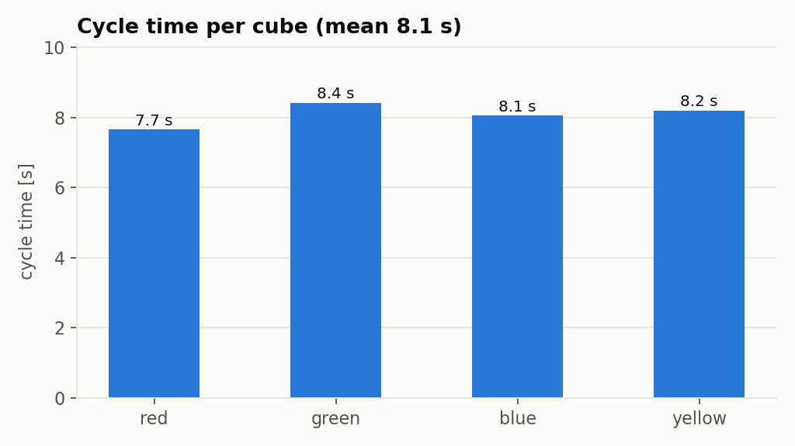

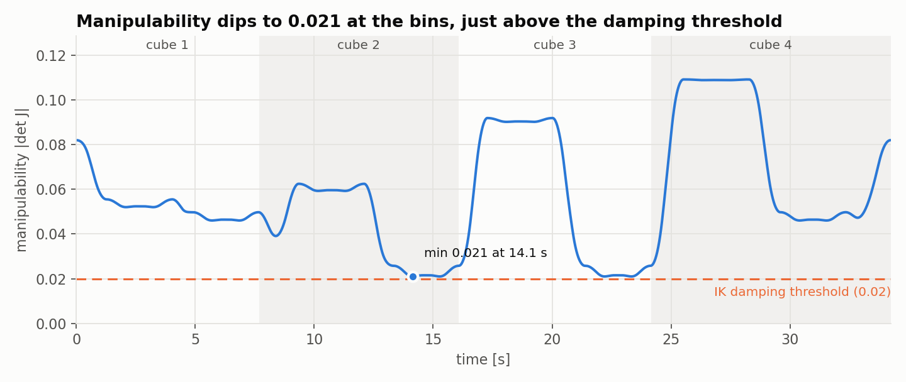

The minimum manipulability is 0.021, at the green and blue bins (near the base). That is just
above the 0.02 level where the IK damping starts, so the cell works but with little margin there.
Moving those bins further from the base would raise it.

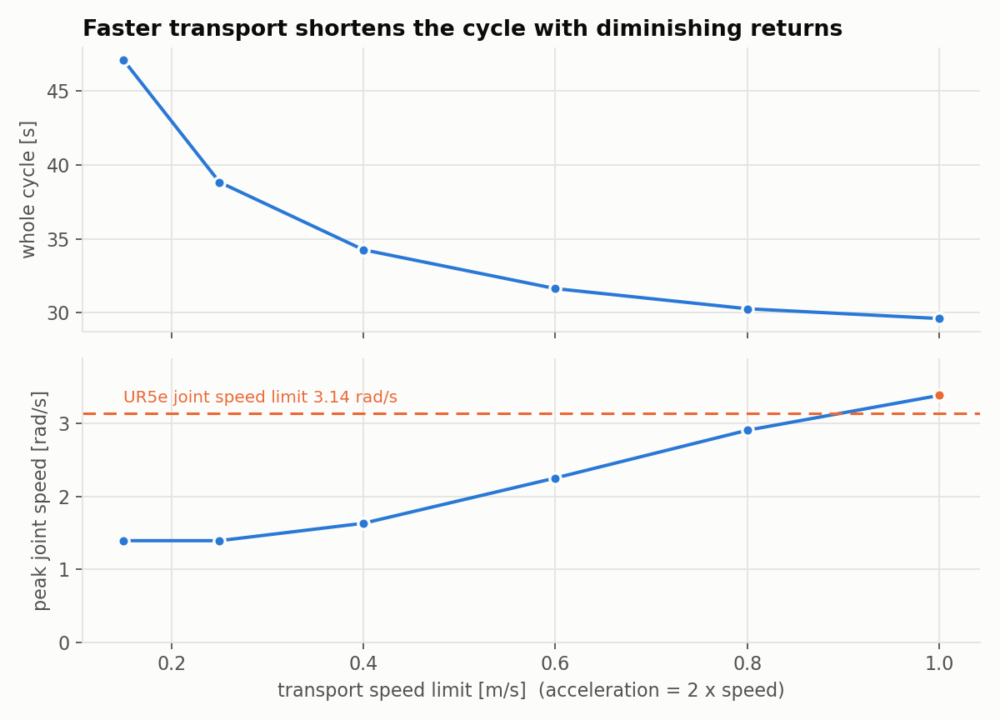

Raising the transport speed from 0.25 to 0.40 m/s saves about 4.5 s per cycle, with diminishing
returns above that. At 1.0 m/s the peak joint speed (3.39 rad/s) exceeds the 3.14 rad/s limit.

## Run it

### Requirements

- ROS 2 Jazzy with `ros-jazzy-ur-description`, RViz, `libmodbus-dev`, `python3-opencv`,
  `libyaml-cpp-dev` (teach mode), `python3-matplotlib` (plots), `python3-yaml`, `pymodbus` (PLC check script only).
- OpenPLC Runtime v4 ([autonomy-logic/openplc-runtime](https://github.com/autonomy-logic/openplc-runtime))
  and OpenPLC Editor v4 to compile and upload the ladder program. The Modbus slave plugin must be
  enabled on port 5020; [`plc/plc_setup.sh`](plc/plc_setup.sh) does this after each upload.

### Build

```
cd ~/sorting_cell_ws
colcon build --symlink-install
source install/setup.bash
```

### Stand-alone (no PLC)

When ROS runs in a Docker container, start everything from the **host** with one command. It
launches the cell inside the container and opens the dashboard in the host's browser as soon as
it answers (it finds the right address whether the container uses host or bridge networking):

```
./scripts/run_cell.sh                     # extra launch arguments are passed on, e.g. use_plc:=true
```

`CONTAINER=name` and `PORT=8766` change the container and the dashboard port. Inside the container
(or on a native ROS install) the launch alone is:

```
ros2 launch sorting_cell_bringup sorting.launch.py
```

then open **http://localhost:8765**, arrange the scene and press **Start sort**
(see [Scene dashboard](#scene-dashboard)). `auto_start:=true` starts by itself after 5 s instead,
`dashboard:=false` leaves the dashboard out.

### With the PLC

1. Open the project in [`plc/sorting_cell`](plc/sorting_cell) with the OpenPLC Editor, build and
   upload, then run `plc/plc_setup.sh`. The ladder spec and the register map are in
   [`plc/ladder_spec.md`](plc/ladder_spec.md) and [`plc/register_map.md`](plc/register_map.md).
2. Check the ladder on its own: `python3 plc/plc_check.py` (expects `28 passed, 0 failed`).
3. Launch the cell:
   ```
   ros2 launch sorting_cell_bringup sorting.launch.py use_plc:=true
   ```
4. Operate it from another shell:
   ```
   ros2 topic pub --once /panel/reset std_msgs/msg/Empty "{}"           # clear the power-up E-stop
   ros2 topic pub --once /panel/start std_msgs/msg/Empty "{}"
   ros2 topic pub --once /panel/stop  std_msgs/msg/Empty "{}"
   ros2 topic pub --once /panel/estop std_msgs/msg/Bool "{data: true}"  # press the E-stop
   ros2 topic pub --once /panel/estop std_msgs/msg/Bool "{data: false}" # release it (reset needed)
   ros2 topic echo /plc/state                # IDLE, RUN, PICK, PLACE, DONE, E-STOP, FAULT, DRIVE_ALARM
   ```
   After a finished cycle, press reset to re-home and scan again.
5. Servo fault demo: jam a joint mid-move (dashboard "Jam joint", or
   `ros2 topic pub --once /drive/inject std_msgs/msg/String "{data: 'jam 2'}"`). The drive trips on
   following error and switches the torque off, the PLC latches DRIVE_ALARM and drops run. Clear
   the jam (`'clear'`), press reset, then start: the cycle resumes.

### Tests and validation

```
ros2 run sorting_cell_controller ik_test             # Jacobian, IK, singularity handling
ros2 run sorting_cell_controller traj_test           # velocity profile and Cartesian planner
ros2 run sorting_cell_controller sort_plan_test      # pick-and-place planning, 300 random scenes
ros2 run sorting_cell_controller plc_link_test       # bridge vs a software PLC (no PLC needed)
ros2 run sorting_cell_controller teach_test           # program file, waypoints, jogs and playback planning
ros2 run sorting_cell_controller fk_checker          # own FK vs TF (needs a running robot_state_publisher)
ros2 run sorting_cell_controller validation_report docs/validation
python3 validation/plot_validation.py docs/validation
ros2 run sorting_cell_controller scene_test           # scene rules, matching, gray container, edit commands, random placement
PYTHONPATH=sorting_cell_vision python3 sorting_cell_vision/test/detect_test.py
PYTHONPATH=sorting_cell_vision python3 sorting_cell_vision/test/scene_codec_test.py
PYTHONPATH=sorting_cell_teach python3 sorting_cell_teach/test/keymap_test.py
PYTHONPATH=sorting_cell_dashboard python3 sorting_cell_dashboard/test/core_test.py
colcon test --packages-select servo_core && colcon test-result --verbose    # servo gtests (from the workspace)
ros2 run sorting_cell_controller drive_report docs/drive              # servo evidence, then:
python3 validation/plot_drive.py docs/drive
```

## Servo drive layer

Without it, the planner's joint angles would be written straight into `joint_states`: the arm would
teleport along the plan. With it, the sequencer sends **targets** (position and velocity, 50 Hz),
a drive closes the joint loops at 1 kHz on simulated joints, and `joint_states` is the **actual**
arm. The arm lags, settles and can fail like a real one, and the FK check runs on the real state.

```
sorting_sequencer --50 Hz targets--> joint_drive (ROS wrapper) --> servo_core firmware --torque--> simulated joints
                  <--drive/ready---                                                   <--encoders--
plc_bridge --plc/estop, plc/reset--> joint_drive          joint_drive --drive/fault--> plc_bridge --> PLC alarm latch
```

**Firmware (`servo_core`, no ROS).** Written the way it would be on a drive's microcontroller:
`float` arithmetic, fixed-size state, no heap, no exceptions, no RTTI, one bounded `step()` per
control period. A CTest checks that the compiled library needs no heap, exception or stdio symbols,
and a gtest counts allocations over 10,000 control steps (zero).

- **Setpoint interpolation:** cubic Hermite segments between the 50 Hz targets (continuous
  position and velocity, one target period of latency), as servo drives do in interpolated mode.
- **Cascaded loops:** position P with velocity feedforward drives a velocity PI that outputs
  torque; gravity feedforward from a nominal model (the payload is not in the model, the
  integrator rejects it). The current loop is taken as ideal.
- **PID building block:** derivative on the measurement (no kick), first-order filtered,
  back-calculation anti-windup, output clamp. Also used as a single-loop position PID for the
  comparison below.
- **Velocity estimate** from a quantised encoder (4096 counts per motor turn, 101:1 gear) through a
  200 Hz low-pass filter.
- **Following-error supervision:** more than 30 mrad (J1-J3) or 50 mrad (J4-J6) for 20 ms trips
  the drive: torque off (STO) and brakes on in the same cycle, latched until reset.
- **E-stop = stop category 1:** the sequencer stops along the path in 0.3 s; the drive supervises
  it with an envelope |v| <= v0 (1 - t / 0.5 s), so the axes stop even if the targets do not, then
  switches the torque off and applies the brakes at standstill (or at a 1 s timeout). The E-stop
  goes to the drive directly, not through the planner, like a hardwired STO input. After a reset
  the drive holds the actual position while the brake opens and moves to the target slowly, so
  re-enabling never jumps.

**Plant (simulation side).** Per joint: torque limit (150/150/150/28/28/28 Nm), speed limit
3.14 rad/s, 101:1 gears with reflected rotor inertia, viscous and Coulomb friction with stiction,
brake, encoder, and the payload. The gravity torque and the inertia each joint sees are computed
from the current pose with UR's published link masses (independent joint control: the
off-diagonal coupling and Coriolis terms are not modelled). Fault injection can jam any joint.

**PLC.** `drive/fault` goes to the PLC (coil 26), which latches `drive_alarm` (coil 11): run drops,
the state shows DRIVE_ALARM and a start is refused until a reset with the drive healthy again. The
same reset push also resets the drive. See [`plc/ladder_spec.md`](plc/ladder_spec.md).

### Results

| Test | Result |
|---|---|
| 0.2 rad shoulder step, P only | 7.1 mrad steady-state error: the shoulder holds the arm against gravity |
| same, PID | error removed (0.007 mrad), but 17 % overshoot, settles in 0.71 s |
| same, cascade P/PI | 0 % overshoot, settles (2 %) in 0.29 s, 0.005 mrad error |
| 1 rad step, PID saturated at 150 Nm | overshoot 29 % with anti-windup, 114 % and a limit cycle without |
| whole sort cycle, 0.5 kg cube | max following error 5.4 mrad (elbow), other joints at most 3.0 mrad (fault limit 30) |
| whole sort cycle, 3 kg payload | max following error 6.1 mrad |
| 3 kg added while holding | peak 3.2 mrad, back under 0.1 mrad in 0.7 s |
| E-stop at the fastest point of a move | stops along the path in 0.32 s, torque off after 0.37 s |
| joint jammed mid-move | following-error trip after 77 ms (20 ms of it debounce), torque off in the same cycle |

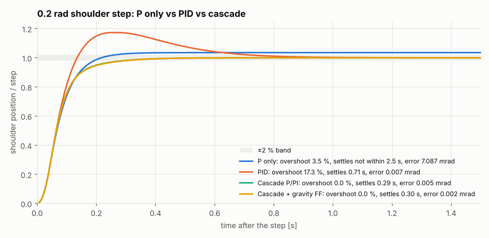

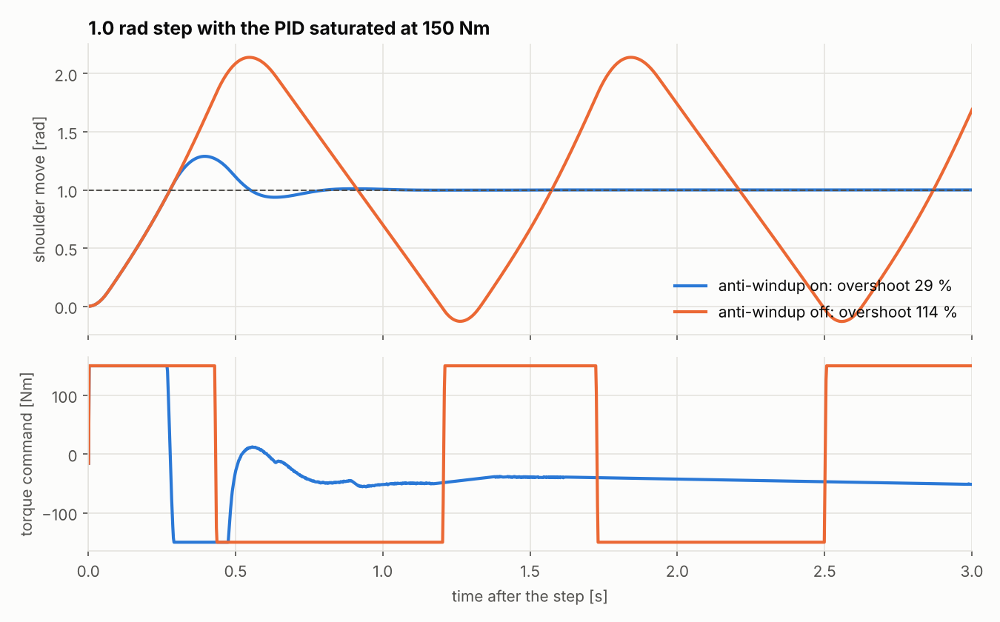

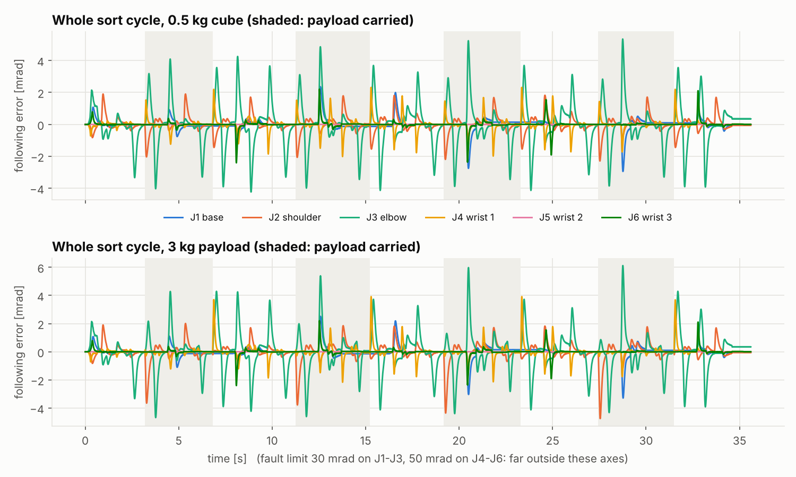

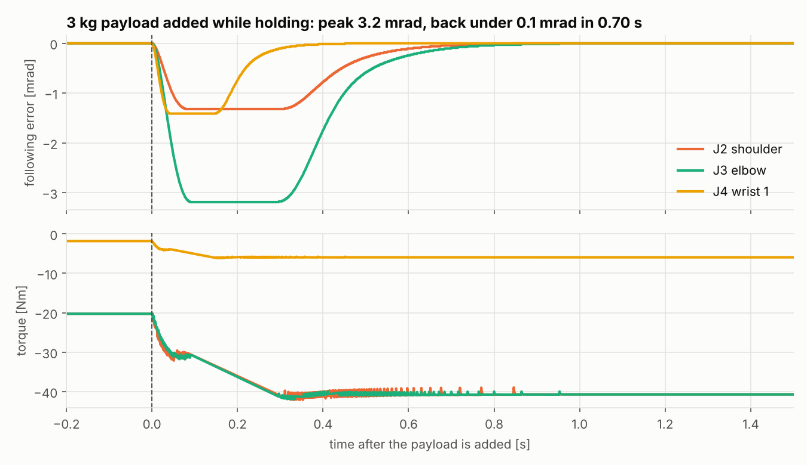

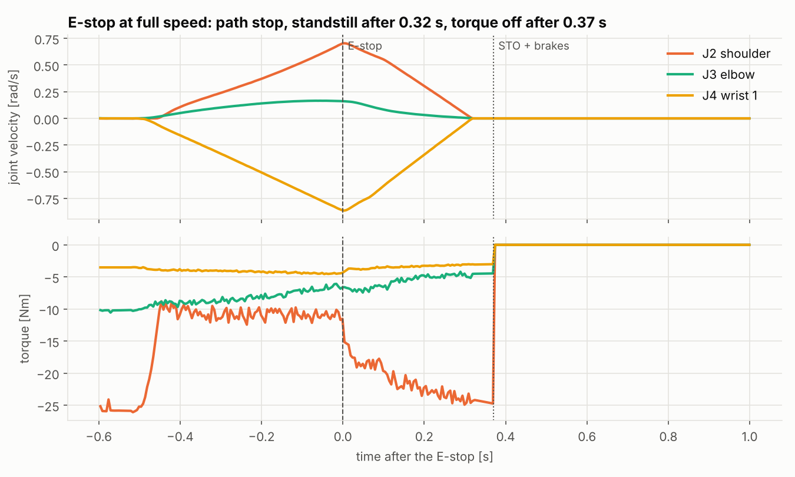

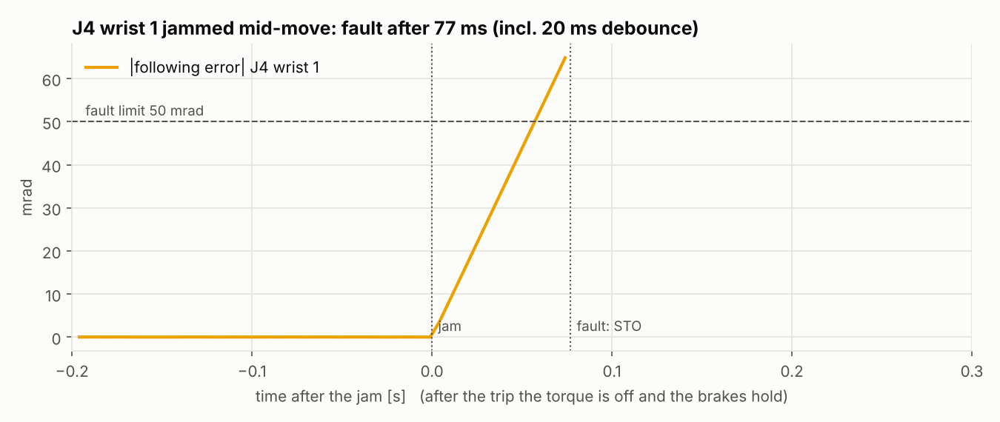

Launch arguments: `drive:=false` puts the planner straight on `joint_states` again (no servo
layer), `cube_mass_kg:=2.0` changes what the drive feels while carrying. Topics:
`drive/state`, `drive/ready`, `drive/fault`, `drive/following_error` (rad per joint),
`drive/inject` (`jam N` / `clear`), `drive/reset` (stand-alone only; with the PLC the PLC reset
resets the drive).

## Scene dashboard

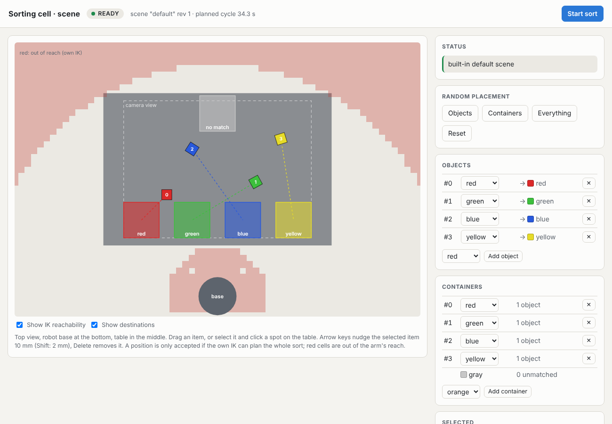

`sorting.launch.py` also starts a small web dashboard (`sorting_cell_dashboard`, Python standard
library HTTP server, no extra packages). Open **http://localhost:8765**. It shows the table from
above with the robot base at the bottom, and every change goes through `scene_server`, so the same
rules and the same IK check apply as for a scene file.

- **Drag** a cube or a container to move it. While dragging, the outline turns green or red as the
  position is checked; on release the move is applied or refused with the reason.
- **Click placement:** select an item (on the table or in a list), then click a spot on the table.
- **Random placement:** Objects, Containers or Everything, each a new arrangement that passes every
  rule and plans with the own IK. Reset reloads the scene file the cell started with.
- **Colours:** a dropdown per object and per container; the arrow next to each object shows where
  it will go (its colour's container, or the gray one).
- **Add / remove** objects and containers; a new item is put at a free, reachable place.
- **IK reachability overlay:** red cells are places the arm cannot reach with the tool pointing down
  (home, hover, grasp height planned with the own IK, 25 mm grid). The whole table lies inside the
  reach; the overlay shows the limit around it and the dead zone next to the base.
- **Servo drive panel:** drive state, following error per joint against its limit, and fault
  injection (jam a joint, clear it, reset the drive) for the demo.
- **Start sort** sends `cell/start`. While the arm moves, editing is locked. With `use_plc:=true`
  the PLC start button decides and the dashboard's Start is disabled.
- Arrow keys nudge the selected item by 10 mm (Shift: 2 mm), Delete removes it. Save and Load
  write and read scene YAML files (paths are inside the ROS machine or container).

`scripts/run_cell.sh` picks the address for you. Without it, if the browser cannot reach the page
(another machine, or a container without host networking), launch with `dashboard_host:=0.0.0.0`
and open `http://<that machine's or container's IP>:8765`. The server only answers requests addressed to `localhost` or an
IP address, and only accepts JSON posts, so other web sites cannot drive it from your browser.

## Scene configuration, colour matching and the gray container

The scene is a YAML file: which cubes lie where, which coloured containers exist and where, and
where the gray container is. The cell reads it at start-up (`scene:=` launch argument), checks it
with the same geometry rules and the same IK/planner that run the arm, and refuses a scene that
cannot be sorted, with the reason.

```yaml
version: 1
name: mismatch
objects:                       # the cubes the camera sees
  - {color: red,    x: -0.40, y: -0.20, yaw: 0.0}
  - {color: yellow, x: -0.62, y:  0.25, yaw: 0.3}
  - {color: purple, x: -0.50, y:  0.00, yaw: 0.8}
containers:                    # one container per colour (140 mm square)
  - {color: red,   x: -0.30, y: -0.30}
  - {color: green, x: -0.30, y: -0.10}
gray_container: {x: -0.72, y: 0.0}   # takes every object with no container of its colour
```

**Matching rule.** An object goes to the container of its own colour. If there is none, it goes to
the gray container. Colours: `red`, `orange`, `yellow`, `green`, `cyan`, `blue`, `purple`
(objects and containers use the same list; gray is reserved for the catch-all container).
Several objects of one colour are fine, they take separate places inside the container (a 3 x 3
grid, 45 mm pitch, so each container holds nine).

| Rule | Limit |
|---|---|
| Objects | 1 to 8; x -0.77..-0.23, y -0.37..0.37 (inside the camera view); at least 0.09 m apart |
| Containers | at most one per colour, up to 7; x -0.73..-0.27, y -0.38..0.38 (fully on the table); no overlaps |
| Object next to a container | the cube must lie outside every container footprint |
| Reachability | the complete sort is planned with the own IK before a scene is accepted; the tool must reach every pick and every drop place |

Check a file before launching it:

```
ros2 run sorting_cell_controller scene_check my_scene.yaml
```

It prints each object with its destination container and the planned cycle time, or the first
problem found. Two examples are installed with the bringup package: `scene_default.yaml` (every
colour has a container) and `scene_mismatch.yaml` (yellow, purple and orange go to gray):

```
ros2 launch sorting_cell_bringup sorting.launch.py scene:=/path/to/my_scene.yaml
ros2 topic pub --once /cell/start std_msgs/msg/Empty "{}"                # begin (or repeat) the sort
```

### Changing the scene while the cell is running

`scene_server` owns the scene and publishes it (`scene/config`); the vision node renders it, the
detector finds the cubes in the image, and the sequencer plans from those detections. Every
message carries a revision number, so cubes of one scene are never planned against containers of
another. Edits are sent as text on `scene/command` and answered on `scene/reply`:

| Command | Effect |
|---|---|
| `move_object I X Y`, `move_container I X Y`, `move_gray X Y` | move one item (indices count from 0) |
| `yaw_object I RADIANS` | rotate an object |
| `color_object I COLOR`, `color_container I COLOR` | recolour (container colours must stay unique) |
| `add_object COLOR X Y [YAW]`, `add_container COLOR X Y`, `remove_object I`, `remove_container I` | change the number of items |
| `random objects`, `random containers`, `random all` | new random positions that pass every rule and the IK check |
| `check_object I X Y`, `check_container I X Y`, `check_gray X Y` | test a position without changing anything |
| `load PATH`, `save PATH`, `reset` | scene files (`~` works) |

```
ros2 topic pub --once /scene/command std_msgs/msg/String "{data: 'color_container 3 purple'}"
ros2 topic echo /scene/reply
```

Every edit is also logged by `scene_server` in the launch terminal, for example
`command 'color_container 3 purple': OK, container 3 is now purple (scene revision 2)` or
`command 'color_container 3 purple': REFUSED, there is no container 3 (valid: 0 to 2)`.

A refused command leaves the scene unchanged and says why. Edits are refused while the arm is
moving; after the cycle the changed scene is planned from scratch. With a PLC, a finished cycle
still waits for the PLC reset, then plans whatever scene is current.

## Teach and playback

A stand-alone mode for programming the arm by hand: move the tool in Cartesian steps, save named
waypoints, record a program of moves, gripper actions and dwells, and play it back or store it as
a YAML file. It uses the same FK, Jacobian, IK and trapezoidal planner as the sorting cell.

```
ros2 launch sorting_cell_bringup teach.launch.py         # shell 1: pendant + RViz
ros2 run sorting_cell_teach teach_keyboard               # shell 2: key-driven client (needs a real terminal)
```

Do not run it together with `sorting.launch.py` (both publish `joint_states`). Teach mode is not
gated by the PLC and has no E-stop.

### Keys

| Key | Action |
|---|---|
| `w` `s` | jog -x / +x in the base frame (`w` is toward the table) |
| `a` `d` | jog -y / +y |
| `r` `f` | jog up / down |
| `q` `e` | rotate the tool about the vertical axis, + / - |
| `+` `-` | step size 2, 5, 10, 20, 50, 100 mm (yaw step is 5 rad per metre of step, 0.05 rad at 10 mm) |
| `m` | save the current pose as a named waypoint and append a `move` step |
| `o` `c` | append a gripper open / close step |
| `t` `h` | append a dwell (asks for seconds) / a home step |
| `g` `H` | go to a waypoint / go home (not recorded) |
| `u` `N` | remove the last step / clear everything |
| `P` `space` `v` `x` | play, pause, resume, stop |
| `W` `L` | write the program to a YAML file / load one |
| `l` `p` `i` | list waypoints / list program steps / show the current pose |
| `?` `Q` | help / quit |

The same commands can be sent as text on `teach/command` (`jog dx dy dz rx ry rz`, `save NAME`,
`gripper open|close`, `dwell SECONDS`, `addhome`, `undo`, `goto NAME`, `home`, `delete NAME`,
`new`, `list`, `steps`, `status`, `write PATH`, `load PATH`, `play`, `pause`, `resume`, `stop`).
Replies appear on `teach/status`:

```
ros2 topic pub --once /teach/command std_msgs/msg/String "{data: 'jog -0.05 0 0 0 0 0'}"
ros2 topic echo /teach/status
```

### Program file

```yaml
version: 1
name: demo_teach
waypoints:
  a_hover:
    position: [-0.4, -0.2, 0.2]                 # metres, robot base frame
    orientation_xyzw: [0.7071, 0.7071, 0, 0]    # tool orientation as a quaternion
  a_grasp:
    position: [-0.4, -0.2, 0.02]
    orientation_xyzw: [0.7071, 0.7071, 0, 0]
steps:
  - move: a_hover
    speed: fast          # optional; the default is the slow transport speed
  - move: a_grasp
  - gripper: close
  - dwell: 0.5           # seconds
  - move: a_hover
  - home: true
```

Step types are `move` (a waypoint name, optional `speed: fast`), `gripper` (`open` or `close`),
`dwell` (seconds) and `home`. A file with an unknown waypoint, an unknown step type or a bad number
is rejected with a message and leaves the current program untouched. A program is compiled before
it plays: every move is solved with the IK from the end of the previous move, so an unreachable
waypoint is reported with its step number before the arm moves. An example is in
[`programs/demo_teach.yaml`](sorting_cell_controller/programs/demo_teach.yaml); load it with `L`.

## Modbus register map

Only coils are used, and the two ranges are disjoint so the PLC scan never overwrites what ROS
wrote. Coil number = 8 x byte + bit of the `%QX` location.

| Direction | Coils | Signals |
|---|---|---|
| PLC to ROS (bridge reads) | 1 to 11 | `run`, `estop_active`, `reset_cmd`, `st_idle`, `st_run`, `st_pick`, `st_place`, `st_done`, `estop_latch`, `st_fault`, `drive_alarm` |
| ROS to PLC (bridge writes) | 16 to 26 | `start_pb`, `stop_pb`, `estop_ok`, `reset_pb`, `at_home`, `cycle_done`, `fault`, `ph_pick`, `ph_place`, `arm_busy`, `drive_fault` |

## Limitations

- The camera is synthetic (a rendered image with noise), not a real sensor. Containers are part of the cell layout and are not detected by the camera.
- "Grasping" is a visual attach of the cube marker to the tool, not physics.
- There is no collision avoidance and no planning around obstacles. Moves are straight lines in
  Cartesian space between hover points.
- The safety logic is a demonstration, not a certified safety system. A real E-stop uses
  safety-rated hardware. The 0.3 s stop ramp is a simulation choice, not a stopping category.
- Teach mode moves along straight lines in Cartesian space with no collision checking, and the gripper step only changes the marker state. It is not PLC-gated.
- Manipulability dips to 0.021 at the bins closest to the base (see Results).
- The joint plant is an independent-joint model: gravity and inertia depend on the pose, but the
  coupling between joints and Coriolis forces are not modelled, link inertia is approximated by
  point masses, and rotor inertia, friction and brake values are assumed, not manufacturer data.
  The current loop is ideal. The firmware is written to be portable to a microcontroller but has
  only run on a PC, against the simulated plant.
- The controlled stop and STO are simulated behaviour, not a safety function (no safety-rated
  hardware, no dual channel).

## Future work

- MoveIt2 for collision-aware planning, compared with the own Cartesian planner.
- Gazebo or Isaac Sim physics with a real gripper, contact grasping and a moving conveyor.
- YOLO-based detection to replace colour thresholding, including mixed object types.
- Live PLC state, cycle count and faults in the scene dashboard.
- Run `servo_core` on a microcontroller (for example an STM32) in hardware-in-the-loop against the
  simulated plant, and wrap the drive as a `ros2_control` hardware interface.
- A real PLC (Mitsubishi, Omron or a Raspberry Pi soft PLC) over Modbus or OPC UA, and a real arm.
- Manual/auto mode, alarm handling and a dual-channel E-stop in the ladder.
