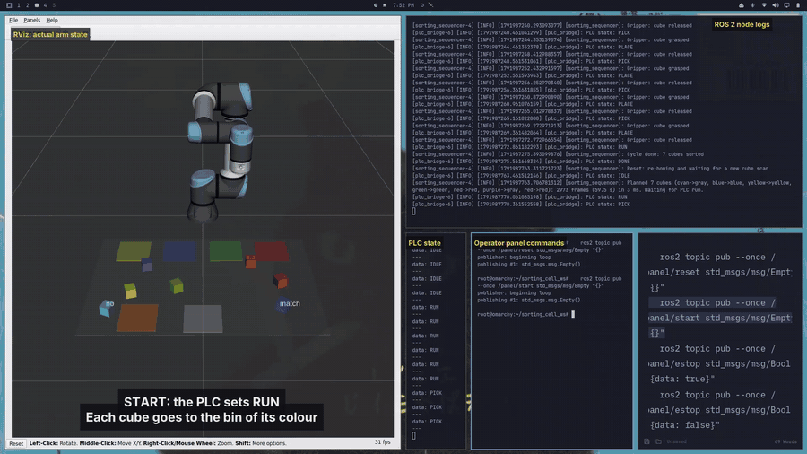

# PLC-supervised robotic sorting cell with from-scratch UR5e kinematics

A simulated sorting cell built the way industrial cells are split up: a **PLC** owns the cycle
sequence and the stop logic, a **PC** does perception and motion planning, and a **servo drive** closes
the joint loops. A UR5e picks coloured cubes and sorts them into coloured bins; cubes with no bin of
their colour go to a gray catch-all bin.

The kinematics (forward kinematics, geometric Jacobian, damped-least-squares inverse kinematics), the
Cartesian trajectory planner and the pick-and-place sequencer are written from scratch in C++ with
Eigen. The servo firmware is a ROS-free C++ library (cascaded position/velocity control, following-error
supervision, controlled stop and torque-off) that drives a simulated UR5e joint plant. The PLC logic is
ladder code running on OpenPLC and is coupled to ROS 2 over Modbus TCP. Everything runs in ROS 2 Jazzy
and is visualised in RViz.


[](https://www.youtube.com/watch?v=sWCEb_UeZGk)

*Demo (2 min): sorting cycle, E-stop and safe resume, drive fault and recovery.*

## Results at a glance

| Area | Result | Reproduce with |
|---|---|---|
| Forward kinematics | Matches the official UR5e joint chain to 2.2e-10 m and 6.2e-10 rad (20,000 random poses) | `kinematics_report` |
| Inverse kinematics | 2000 / 2000 tool-down table poses solved from the home pose; 0 joint-limit violations | `kinematics_report` |
| Sorting cycle | 4 cubes in 34.3 s planned (8.1 s per cube average), peak joint speed 1.63 rad/s | `validation_report` |
| Servo tracking | Max following error 5.4 mrad over a full cycle with a 0.5 kg cube (trip limit 30 mrad) | `drive_report` |
| Controlled stop | E-stop at 0.86 rad/s: arm stopped in 0.32 s, torque off after 0.37 s | `drive_report` |
| Fault detection | Jammed joint trips the drive after 77 ms; the PLC latches the alarm and drops `run` | `drive_report` |
| PLC | 28 checks of the running ladder over Modbus (E-stop latch and reset, start interlocks, stop, cycle done, faults, drive alarm) | `plc/plc_check.py` |

Numbers come from the tools in this repository. Section [Simulation scope and limitations](#simulation-scope-and-limitations)
states what the simulation does not cover.

## 1. System architecture

| Layer | Role | Implementation |
|---|---|---|
| PLC | Cycle states, start interlocks, E-stop latch, drive alarm latch | Ladder logic on OpenPLC (Modbus TCP slave, port 5020) — [`plc/`](plc) |
| Bridge | Polls PLC outputs, writes robot status to the PLC, 20 Hz | C++ / libmodbus — [`plc_bridge.cpp`](sorting_cell_controller/src/plc_bridge.cpp) |
| Perception | Finds cubes and their colours | Python / OpenCV — [`sorting_cell_vision`](sorting_cell_vision) |
| Motion | FK, Jacobian, IK, Cartesian planning, pick-and-place sequencing | C++ / Eigen — [`sorting_cell_controller`](sorting_cell_controller) |
| Servo drive | 1 kHz joint control, supervision, stop, torque off | ROS-free C++ — [`servo_core`](servo_core), ROS wrapper [`joint_drive.cpp`](sorting_cell_controller/src/joint_drive.cpp) |
| Visualisation | UR5e, table, bins, cubes in RViz | `robot_state_publisher` + RViz — [`sorting_cell_bringup`](sorting_cell_bringup) |

**Signal flow.** The camera image is processed into cube poses and colours; the sequencer plans the
whole sort from those detections with its own IK and sends joint targets (position and velocity, 50 Hz)
to the servo drive. The drive closes the joint loops at 1 kHz on the simulated joints and publishes the
**actual** joint state, which RViz shows. The PLC decides whether the cell may run; the bridge passes
its `run` and E-stop outputs to the ROS nodes and writes the arm's status back to the PLC.

**Why the work is split this way.** The PLC holds the deterministic, safety-related logic: whether the
cell is allowed to run, what state it is in, and what has to happen before it can start again. The PC
does the compute-heavy work that does not belong in a PLC (image processing, kinematics, trajectory
planning). The drive layer sits between them, as in a real arm, so that the planner's output is a
*request* that the joints follow with lag and limits, not a teleport.

## 2. Kinematics (from scratch, C++/Eigen)

Source: [`ur5e_kinematics.hpp`](sorting_cell_controller/include/sorting_cell_controller/ur5e_kinematics.hpp),
[`ur5e_ik.hpp`](sorting_cell_controller/include/sorting_cell_controller/ur5e_ik.hpp).

### Forward kinematics

Standard Denavit–Hartenberg convention, link transform `A_i = Rz(θ_i) Tz(d_i) Tx(a_i) Rx(α_i)` with
`θ_i = q_i`, tool-flange pose `T = A_1 … A_6` in the robot base frame (metres, radians).

| i | a_i [m] | d_i [m] | α_i [rad] |
|---|---|---|---|
| 1 | 0 | 0.1625 | π/2 |
| 2 | −0.4250 | 0 | 0 |
| 3 | −0.3922 | 0 | 0 |
| 4 | 0 | 0.1333 | π/2 |
| 5 | 0 | 0.0997 | −π/2 |
| 6 | 0 | 0.0996 | 0 |

The lengths were cross-checked against `ur_description/config/ur5e/default_kinematics.yaml`.

### Geometric Jacobian

Joint *i* rotates about the z axis of frame *i−1*, so with `z_{i−1}` and `p_{i−1}` taken before link *i*'s
transform is applied:

```
J_v,i = z_{i-1} × (p_e − p_{i-1})        J_w,i = z_{i-1}        J = [J_v ; J_w]  (6×6, base frame)
```

The manipulability measure is `w = sqrt(det(J Jᵀ)) = |det J|` (the Jacobian is square). Its units mix
metres and radians, so it is only compared between poses of the same robot.

### Inverse kinematics: adaptive damped least squares

The pose error is `e = [p_d − p ; rotvec(R_d Rᵀ)]` and each iteration takes the step

```
Δq = Jᵀ (J Jᵀ + λ² I)⁻¹ e
```

- **Adaptive damping.** `λ² = λ_min²` (λ_min = 0.01) away from singularities; as `w` falls below
  `w₀ = 0.02`, `λ²` ramps to `λ_max²` (λ_max = 0.10): `λ² = λ_min² + (λ_max² − λ_min²)(1 − (w/w₀)²)`.
- **Step clamp.** The largest joint step per iteration is limited to 0.2 rad.
- **Joint limits.** Every iterate is clamped to the limits (±2π, elbow ±π, as in `ur_description`).
- **Seeding.** Along a path each solve starts from the previous solution, so the solution stays on one
  branch and consecutive samples are continuous.
- **Convergence.** Position error below 1e-5 m and rotation error below 1e-4 rad, at most 500 iterations.
  A solve that does not converge fails the whole plan with the step where it happened.

The solver is local: it finds the solution nearest the seed and does not enumerate the up to eight
analytic UR5e solutions.

### Verification

| Check | Result |
|---|---|
| FK against the URDF joint chain (`kinematics_report`, 20,000 random joint vectors in limits) | max position error 2.2e-10 m, max rotation error 6.2e-10 rad |
| FK against TF from `robot_state_publisher` (`fk_checker`, live, arm at rest) | max position error 5.8e-11 m |
| Jacobian against central finite differences of the FK (5000 random poses, position and rotation rows) | max absolute difference 2.9e-10 |
| IK, tool-down poses over the table, seed = home | 2000 / 2000 converged |
| IK, random targets anywhere in the limits, seed within about 0.1 rad of the answer | 91 % converge |
| same, seed within about 0.5 rad | 86 % converge |
| same, seed = home pose | 76 % converge (local solver; the targets include poses that are far from home) |
| IK near a wrist singularity (q5 ≈ 0) / near an elbow singularity (q3 ≈ 0) | 27 % / 11 % reach the 1e-5 m tolerance in 500 iterations; the remaining residual stays below 1 mm |
| IK solutions outside the joint limits | 0 |
| IK along a 100-point Cartesian line | 0 failures, 1.0 iterations per sample on average |

The IK figures are from [`kinematics_report`](sorting_cell_controller/src/kinematics_report.cpp) and
[`ik_test`](sorting_cell_controller/src/ik_test.cpp). Failure rates for random targets are a property of
the local solver and are reported, not hidden: the cell only uses tool-down poses over the table, where
the solver converged in every case tested.

## 3. Trajectory planning and pick-and-place

Source: [`trajectory.hpp`](sorting_cell_controller/include/sorting_cell_controller/trajectory.hpp),
[`pick_place.hpp`](sorting_cell_controller/include/sorting_cell_controller/pick_place.hpp).

**Cartesian path.** A move is a straight line in position plus spherical linear interpolation (slerp) in
orientation, both driven by **one** trapezoidal profile `s(t)` over a normalised path coordinate, so
translation and rotation start and stop together. The profile limits are the tightest of the linear
(`v_lin/L`, `a_lin/L`) and angular (`v_ang/θ`, `a_ang/θ`) limits for the move. A move too short to reach
cruise speed becomes a triangular profile. The path is sampled at 50 Hz and each sample is solved with
the IK above, seeded from the previous sample.

| Move type | Linear speed / acceleration | Angular speed / acceleration |
|---|---|---|
| Descend, ascend (near the table) | 0.25 m/s, 0.50 m/s² | 1.0 rad/s, 2.0 rad/s² |
| Transport between hover points | 0.40 m/s, 0.80 m/s² | 1.5 rad/s, 3.0 rad/s² |

**Pick-and-place sequence** for each cube, tool pointing down: hover over the cube (z = 0.20 m) → descend
to grasp height (z = 0.02 m) → hold 0.3 s (grasp) → ascend → transport to a hover point over the cube's bin
→ descend → hold 0.3 s (release) → retreat. Cubes of the same colour take separate slots in their bin (3 × 3
grid, 45 mm pitch). The sequencer plans the entire cycle up front and refuses a scene it cannot plan.

**Results.**

| Check | Result |
|---|---|
| Trapezoid profile (`traj_test`) | tool speed 0.250 m/s at the limit, line deviation below 1e-5 m, end error below 3e-7 m; an unreachable goal fails cleanly |
| Pick-and-place planning (`sort_plan_test`) | 300 / 300 random 4-cube scenes planned |
| Planned cycle, demo scene | 8.1 s per cube on average (7.7–8.4 s); 34.3 s for the cycle including the return home |
| Cycle with the servo drive in the loop | 34.6 s |
| Peak joint speed, demo scene | 1.63 rad/s (UR5e limit 3.14 rad/s) |


**Manipulability.** The minimum over the cycle is 0.021, at the green and blue bins (closest to the base).
That is just above the 0.02 level where the IK damping starts: the cell works there with little margin, and
moving those bins further from the base would raise it.


**Transport speed trade-off.** The sweep varies the transport speed (acceleration = 2 × speed):

| Transport speed [m/s] | Cycle [s] | Peak joint speed [rad/s] |
|---|---|---|
| 0.15 | 47.1 | 1.39 |
| 0.25 | 38.8 | 1.39 |
| 0.40 (default) | 34.3 | 1.63 |
| 0.60 | 31.6 | 2.25 |
| 0.80 | 30.3 | 2.91 |
| 1.00 | 29.6 | 3.39 (exceeds the 3.14 rad/s limit) |


The planner limits Cartesian speed only. Joint speed is checked after planning, not enforced: over 300
random scenes the highest planned joint speed was 2.97 rad/s, and no scene exceeded 3.14 rad/s.

## 4. Perception

[`sorting_cell_vision`](sorting_cell_vision) renders a synthetic top-down image of the table with noise,
finds the cubes by HSV thresholding and contour extraction, converts the pixel centroids to table
coordinates with a fixed mapping, and publishes a pose and a colour label per cube. Seven colours are
supported (red, orange, yellow, green, cyan, blue, purple). The sequencer plans from these detections, not
from the scene file.

| Check | Result |
|---|---|
| 400 random scenes with noise (`check_detector.py`) | 0 misses, worst position error 0.66 mm |
| Robustness (`validation/vision_robustness.py`) | brightness ×0.6 to ×0.8, colour cast, noise and blur: no misses |
| Brightness ×1.3 | orange is lost |
| Hue shift | ±6 gives 2 / 14 colour errors, ±8 gives 8 / 14 |
| Two cubes closer than about 40 mm | merge into one detection |

The renderer and the detector share one camera model, so the first row verifies the image processing,
not a camera calibration.

## 5. Servo drive layer

Without this layer the planner's joint angles would be written straight into `joint_states`. With it, the
sequencer sends *targets*, a drive closes the joint loops at 1 kHz on simulated joints, and `joint_states`
is the **actual** arm. The arm lags, settles and can fail, and the FK check runs on the real state.

```
sorting_sequencer --50 Hz targets--> joint_drive (ROS wrapper) --> servo_core firmware --torque--> simulated joints
                  <--drive/ready---                                                   <--encoders--
plc_bridge --plc/estop, plc/reset--> joint_drive          joint_drive --drive/fault--> plc_bridge --> PLC alarm latch
```

### Firmware (`servo_core`, no ROS)

Written in the style of drive firmware: `float` arithmetic, fixed-size state, no heap, no exceptions, no
RTTI, one bounded `step()` per control period. A CTest checks that the compiled library needs no heap,
exception or stdio symbols, and a gtest counts allocations over 10,000 control steps (zero).

- **Setpoint interpolation.** Cubic Hermite segments between the 50 Hz targets (continuous position and
  velocity, one target period of latency), as in the interpolated mode of servo drives.
- **Cascaded loops.** Position P with velocity feedforward feeds a velocity PI that outputs torque, plus
  gravity feedforward from a nominal model (the payload is not in the model; the integrator rejects it).
  The current loop is taken as ideal. Tuning rule: velocity-loop bandwidth ω_v = 60 rad/s (wrists
  120 rad/s) at a nominal joint inertia, `k_p,vel = J_nom ω_v`, `k_i,vel = k_p,vel ω_v / 5`, `k_p,pos = ω_v / 4`.
- **PID block.** Derivative on the measurement (no derivative kick), first-order filtered, back-calculation
  anti-windup, output clamp. Used as a single-loop position PID for the comparison below.
- **Velocity estimate.** From a quantised encoder (4096 counts per motor turn, 101:1 gear) through a
  200 Hz low-pass filter. Setpoint speed is limited to 2.9 rad/s, below the 3.14 rad/s joint limit.
- **Following-error supervision.** A following error above 30 mrad (joints 1–3) or 50 mrad (joints 4–6)
  for 20 ms trips the drive: torque off and brakes on in the same cycle, latched until reset.
- **Controlled stop (stop category 1 behaviour).** The sequencer stops along the path in 0.3 s; the drive
  independently enforces the envelope `|v| ≤ v₀ (1 − t / 0.5 s)`, so the axes stop even if the targets
  do not, then switches the torque off and applies the brakes at standstill (or after a 1 s timeout).
  The stop signal goes to the drive directly, not through the planner. After a reset the drive holds the
  actual position while the brake opens and then moves slowly to the target, so re-enabling never jumps.

### Plant (simulation side)

Per joint: torque limit (150 / 150 / 150 / 28 / 28 / 28 Nm), speed limit 3.14 rad/s, 101:1 gear with
reflected rotor inertia, viscous and Coulomb friction with stiction, brake, encoder and payload. Gravity
torque and the inertia each joint sees are computed from the current pose with UR's published link masses
(independent-joint model: coupling between joints and Coriolis terms are not modelled). Torque limits and
speed limit come from `ur_description`; rotor inertia, friction and brake values are assumed, not
manufacturer data. Fault injection can jam any joint.

### Results

| Test | Result |
|---|---|
| 0.2 rad shoulder step, P only | 7.1 mrad steady-state error (the shoulder holds the arm against gravity) |
| same, single-loop PID | steady-state error removed (0.007 mrad), 17 % overshoot, settles in 0.71 s |
| same, cascade P/PI | 0 % overshoot, settles (2 %) in 0.29 s, 0.005 mrad error |
| 1 rad step, PID saturated at 150 Nm, integral gain tripled for this test | overshoot 29 % with anti-windup; 114 % and a limit cycle without |
| Whole sort cycle, 0.5 kg cube | max following error 5.4 mrad (elbow), other joints at most 3.0 mrad (fault limit 30 mrad) |
| Whole sort cycle, 3 kg payload | max following error 6.1 mrad |
| 3 kg added while holding | peak 3.2 mrad, back under 0.1 mrad in 0.7 s |
| E-stop at the fastest point of the first transport move (0.86 rad/s) | stops along the path in 0.32 s, torque off after 0.37 s |
| Joint jammed mid-move | following-error trip after 77 ms (20 ms of it debounce), torque off in the same cycle |


The firmware is checked by 18 gtests (`colcon test --packages-select servo_core`), including the
no-heap/no-exception symbol check.

## 6. PLC logic and safety behaviour

The ladder program ([`plc/sorting_cell`](plc/sorting_cell), specification in
[`plc/ladder_spec.md`](plc/ladder_spec.md)) has 16 rungs:

| Rung | Function |
|---|---|
| R1–R4 | Normally-closed E-stop loop (`estop_ok = 1` is healthy): an open loop sets `estop_active`, which sets the latch; only a reset with the loop closed clears it |
| R5–R7 | Start permissive: the arm is at home, or a cycle was interrupted after leaving home |
| R8 | Self-holding start/stop circuit that drops `run` on stop, E-stop latch, fault, cycle done or drive alarm |
| R9–R14 | Cycle state outputs: IDLE, RUN, PICK, PLACE, DONE, FAULT |
| R15–R16 | Latched servo drive alarm, set by the drive's trip and cleared by a reset once the drive is healthy |

- **Interlocks gate the start only.** A start needs: arm at home *or* an interrupted cycle, no fault, E-stop
  loop closed and latch clear. Once running, the arm no longer has to be at home.
- **Power-up state.** The E-stop loop coil is 0 until the bridge connects, so the cell starts in E-STOP and
  needs a reset, as a real cell would.
- **Resume.** After an E-stop or stop, the arm decelerates to zero and holds; after reset and start it
  continues the same trajectory from where it stopped.
- **Drive alarm.** A drive trip (following error) goes to the PLC (coil 26), which latches `drive_alarm`:
  `run` drops, the state shows DRIVE_ALARM and a start is refused until a reset with the drive healthy.
  The same reset push also resets the drive.

### Modbus register map

Only coils are used, and the two ranges are disjoint so the PLC scan never overwrites what ROS wrote. The
coil number is 8 × byte + bit of the `%QX` location. Push buttons are momentary: the bridge holds
start/stop/reset high for 0.5 s per press.

| Direction | Coils | Signals |
|---|---|---|
| PLC to ROS (bridge reads) | 1 to 11 | `run`, `estop_active`, `reset_cmd`, `st_idle`, `st_run`, `st_pick`, `st_place`, `st_done`, `estop_latch`, `st_fault`, `drive_alarm` |
| ROS to PLC (bridge writes) | 16 to 26 | `start_pb`, `stop_pb`, `estop_ok`, `reset_pb`, `at_home`, `cycle_done`, `fault`, `ph_pick`, `ph_place`, `arm_busy`, `drive_fault` |

Details: [`plc/register_map.md`](plc/register_map.md).

### Verification

| Check | Result |
|---|---|
| Ladder on OpenPLC (`plc/plc_check.py`) | 28 checks over Modbus against the running ladder |
| Bridge against a software PLC (`plc_link_test`) | 39 / 39 checks |

## 7. Additional tools

- **Scene configuration and dashboard.** A YAML scene (cube positions and colours, one container per colour,
  a gray catch-all container) is checked with the same geometry rules and the same IK/planner that run the
  arm, and a scene that cannot be sorted is refused with the reason. A browser dashboard edits the scene
  while the cell is idle (drag, click placement, random layouts, colours, IK reachability overlay) and
  shows the servo drive state. Details in [docs/usage.md](docs/usage.md).
- **Teach and playback.** Jog the tool in Cartesian steps, save named waypoints, record a program of moves,
  gripper actions and dwells, and replay it or store it as YAML. It uses the same FK, Jacobian, IK and
  planner. Teach mode is not gated by the PLC and has no E-stop. Details in [docs/usage.md](docs/usage.md).


## 8. Build and run

Requirements: ROS 2 Jazzy with `ros-jazzy-ur-description`, RViz, `libmodbus-dev`, `libyaml-cpp-dev`,
`python3-opencv`, `python3-matplotlib`, `python3-yaml`, and `pymodbus` (PLC check script only). The PLC
needs OpenPLC Runtime v4 ([autonomy-logic/openplc-runtime](https://github.com/autonomy-logic/openplc-runtime))
with its Modbus slave on port 5020 (enabled by [`plc/plc_setup.sh`](plc/plc_setup.sh)) and the OpenPLC Editor
to compile and upload [`plc/sorting_cell`](plc/sorting_cell).

```
cd ~/sorting_cell_ws
rosdep install --from-paths src --ignore-src -y
colcon build --symlink-install
source install/setup.bash

ros2 launch sorting_cell_bringup sorting.launch.py                 # stand-alone, no PLC
ros2 launch sorting_cell_bringup sorting.launch.py use_plc:=true   # PLC-supervised
```

The dashboard is at **http://localhost:8765**. With the PLC, operate the cell from another shell:

```
ros2 topic pub --once /panel/reset std_msgs/msg/Empty "{}"            # clear the power-up E-stop
ros2 topic pub --once /panel/start std_msgs/msg/Empty "{}"
ros2 topic pub --once /panel/estop std_msgs/msg/Bool "{data: true}"   # press the E-stop
ros2 topic echo /plc/state
```

The full procedure (Docker helper script, PLC upload, servo fault demo) is in [docs/usage.md](docs/usage.md).

Run the tests and the measurements:

```
colcon test && colcon test-result --verbose
ros2 run sorting_cell_controller kinematics_report $(ros2 pkg prefix ur_description)/share/ur_description/config/ur5e/default_kinematics.yaml
ros2 run sorting_cell_controller validation_report docs/validation
ros2 run sorting_cell_controller drive_report docs/drive
python3 validation/vision_robustness.py
python3 plc/plc_check.py          # needs the PLC runtime with the ladder uploaded
```

A GitHub Actions workflow ([`.github/workflows/ci.yml`](.github/workflows/ci.yml)) builds the workspace and
runs the tests in a `ros:jazzy` container.

## Simulation scope and limitations

- The camera is synthetic (a rendered image with noise), not a real sensor. Containers are part of the cell
  layout and are not detected by the camera.
- The camera renders the scene file, not the state of the cell: after a cycle the cubes are back where the
  scene says, and nothing senses that a cube actually arrived in its bin.
- The IK is a local solver (damped least squares from a seed). It is reliable for the tool-down poses the
  cell uses, not for arbitrary poses from a distant seed.
- The planner limits tool speed, not joint speed; joint speeds are checked in tests, not enforced.
- The E-stop button is a software input written to the PLC over Modbus. In a real cell it would be a
  hardwired input of a safety relay or safety PLC. The PLC latch, the reset rule and the gating of motion
  are real ladder logic.
- There are no communication watchdogs. If the bridge or another node dies, the remaining nodes keep the
  last `run`/`estop` values and the PLC keeps its coils.
- `at_home` (used by the PLC start interlock) and the gripper state follow the planned trajectory, not
  measured positions; a grasp does not check where the tool actually is.
- "Grasping" is a visual attach of the cube marker to the tool, not physics.
- There is no collision avoidance. Moves are straight lines in Cartesian space between hover points; teach
  mode likewise has no collision checking.
- The PLC is OpenPLC, a soft PLC in Docker, not a production PLC.
- The controlled stop, torque-off and brake behaviour are simulated; this is a demonstration, not a
  certified safety system (no safety-rated hardware, no dual channel). The 0.3 s stop ramp is a simulation
  choice, not a stopping-category requirement.
- The joint plant is an independent-joint model without joint coupling and Coriolis terms; link inertia is
  approximated by point masses; the current loop is ideal. The firmware is written to be portable to a
  microcontroller but has only run on a PC against the simulated plant.

## What I would do next

- Communication watchdogs: a heartbeat coil checked by a timer in the ladder, and timeouts on PLC and drive
  messages in the ROS nodes, so a dead process stops the cell.
- Measure `at_home` from the joints, fault the cycle when the tool is not at the cube at grasp time, and
  freeze the gripper state during a stop.
- Enforce joint speed and acceleration limits in the planner by re-timing segments that exceed them.
- Integration tests with `launch_testing`: a full cycle and an E-stop in every phase, in CI.
- MoveIt 2 for collision-aware planning, compared with the own Cartesian planner.
- Gazebo or Isaac Sim physics with a real gripper, contact grasping and a moving conveyor.
- A learned detector (for example YOLO) in place of colour thresholding.
- Run `servo_core` on a microcontroller in hardware-in-the-loop against the simulated plant, and wrap the
  drive as a `ros2_control` hardware interface.
- A real PLC and arm over Modbus or OPC UA.

## Repository layout

| Path | Contents |
|---|---|
| `sorting_cell_controller/` | C++: kinematics, IK, planner, sequencer, scene server, PLC bridge, drive node, teach pendant, tests and report tools |
| `servo_core/` | ROS-free servo firmware library and simulated UR5e joint plant, with gtests |
| `sorting_cell_vision/` | Python: synthetic camera and HSV cube detector |
| `sorting_cell_dashboard/` | Python: browser dashboard for the scene |
| `sorting_cell_teach/` | Python: keyboard client for teach mode |
| `sorting_cell_bringup/` | Launch files, RViz configurations, scene files |
| `plc/` | OpenPLC project (ladder), ladder spec, register map, Modbus setup and check scripts |
| `validation/` | Plot and robustness scripts that regenerate the figures in `docs/` |
| `docs/` | Architecture diagram, result figures, [operating guide](docs/usage.md) |
| `scripts/run_cell.sh` | Starts the cell in a Docker container and opens the dashboard on the host |

## License

MIT, see [LICENSE](LICENSE).
